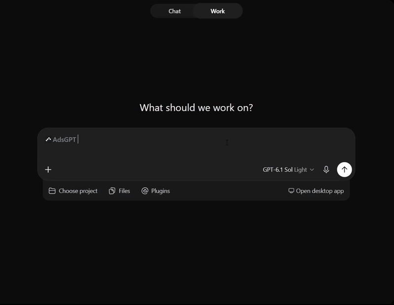

[](https://adsgpt.dev)

# AdsGPT for AI agents

Ask your AI agent how your ad campaigns are doing, find the spend that doesn't convert, and change
budgets, bids, keywords and ads, or create new campaigns, from Claude, ChatGPT, Codex, Cursor, Grok
or any MCP client. Every change waits for your approval, and new campaigns are created paused.

AdsGPT works with Google Ads, Meta Ads, TikTok Ads, LinkedIn Ads, X Ads, Reddit Ads, Unity Ads,
OpenAI Ads and Wortise Ads. Your AI agent reaches Google Ads today, and the other platforms are on
their way to the MCP server; meanwhile, they work in [AdsGPT](https://app.adsgpt.dev)'s own
assistant. See [Ad platforms](https://docs.adsgpt.dev/platforms/).



[Watch the 50-second demo](.github/assets/adsgpt-demo.mp4) · [Documentation](https://docs.adsgpt.dev) · [AdsGPT](https://adsgpt.dev)

This repository is the AdsGPT plugin: the [AdsGPT MCP server](https://docs.adsgpt.dev/how-it-works/)
plus the [skills](plugins/adsgpt/skills) that guide the model through each task, packaged for each
client. You need an [AdsGPT account](https://app.adsgpt.dev) with an ad platform connected.

## What you can ask

For example, with Google Ads:

| You ask | AdsGPT does |
| --- | --- |
| _How did my Google Ads campaigns do last week?_ | Reports impressions, clicks, cost and conversions per campaign, in your currency. |
| _Find the search terms that spend without converting in the last 30 days._ | Lists them by cost and proposes negative keywords, adding them only if you approve. |
| _Why did my cost per conversion go up this week?_ | Compares the week with the one before: the metrics, campaigns and devices that moved, and the changes made in between. |
| _Find keyword ideas for my site and forecast them with a max CPC of 1._ | Researches keywords and search volumes with Keyword Planner, and estimates their clicks and cost. |
| _Create a search campaign for https://example.com with a budget of 300 for the next 30 days._ | Reads your site, writes the ads within Google's limits and creates the campaign, paused, after you approve it. |

More in the [example prompts](https://docs.adsgpt.dev/guides/example-prompts/).

## Install

| Client | How |
| --- | --- |
| **Claude Code** | `/plugin marketplace add adsgpt-dev/agent-plugins`, then `/plugin install adsgpt@adsgpt` |
| **Claude** (web and desktop) | **Customize > Plugins > Add > Add marketplace**: `adsgpt-dev/agent-plugins` |
| **ChatGPT** | Install **AdsGPT** from [chatgpt.com/plugins](https://chatgpt.com/plugins) |
| **Codex** | `codex plugin marketplace add adsgpt-dev/agent-plugins`, then `codex plugin add adsgpt@adsgpt` |
| **Grok Build** | Reads the plugin from Claude Code, or add the marketplace `adsgpt-dev/agent-plugins` |
| **Cursor, VS Code, Antigravity, Windsurf and other MCP clients** | Add the MCP server `https://mcp.adsgpt.dev` |
| **Skills only** | `npx skills add adsgpt-dev/agent-plugins` (they need the MCP server too) |

Your agent signs in with your AdsGPT account through OAuth the first time it needs it: there are no
API keys. Step-by-step guides for each client are in [Connect your AI](https://docs.adsgpt.dev/connect/).

## What's inside

| Path | What it is |
| --- | --- |
| [`plugins/adsgpt`](plugins/adsgpt) | The plugin: a manifest for each client, the address of the MCP server and the skills. Its [README](plugins/adsgpt/README.md) says what it runs, sends and reads. |
| [`plugins/adsgpt/skills`](plugins/adsgpt/skills) | The skills: the rules for working with ad accounts, creating campaigns, writing ads, optimizing spend, and Google Ads. Plain Markdown, with no scripts. |
| [`registry/adsgpt`](registry/adsgpt) | The server's entry in the official MCP Registry. |

The MCP server runs in the cloud at `https://mcp.adsgpt.dev`. The plugin runs nothing on your
machine. See [Security and privacy](https://docs.adsgpt.dev/security/) and the
[privacy policy](https://adsgpt.dev/privacy).

## For maintainers

### Build the plugin for OpenAI

OpenAI's plugin portal takes each plugin as a ZIP. Build it from a committed ref:

```bash
scripts/build-openai-zip.sh            # adsgpt from main
scripts/build-openai-zip.sh adsgpt v1  # another plugin or ref
```

It writes `<plugin>-<version>.zip` in the current directory, with the Codex manifest, the MCP server,
the skills, the assets, the README, the privacy policy and the license.

### MCP Registry

`registry/<plugin>/server.json` describes each plugin's MCP server for the official
[MCP Registry](https://registry.modelcontextprotocol.io), where clients discover it. AdsGPT is
`dev.adsgpt/adsgpt`: the registry verifies the `dev.adsgpt` namespace with a TXT record on
`adsgpt.dev` and the Ed25519 key that signs it. To publish a new version, raise `version` and run:

```bash
cd registry/adsgpt
mcp-publisher login dns --domain adsgpt.dev \
  --private-key "$(openssl pkey -in ~/.config/mcp-registry/adsgpt.dev.pem -outform DER | tail -c 32 | xxd -p -c 64)"
mcp-publisher publish
```

## Support

Open an [issue](https://github.com/adsgpt-dev/agent-plugins/issues) with your client, what you asked
and the error you got.

## License

MIT (`LICENSE`).
